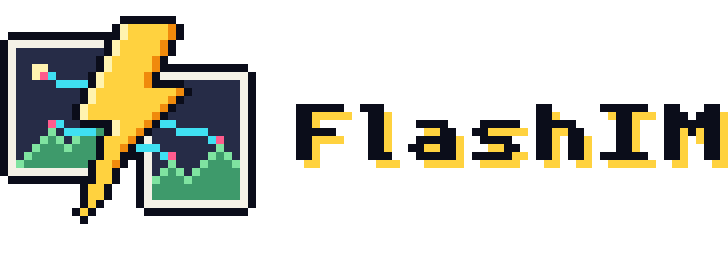

<p align="center">
  <picture>
    <source media="(prefers-color-scheme: dark)" srcset="assets/brand/lockup-dark@8x.png">
    
  </picture>
</p>

<p align="center">
  <b>Fast, quantized, multi-platform inference for image matching.</b><br>
  Dense and sparse matchers as native PyTorch ports, with FP8 / INT8 quantization and custom kernels.
</p>

<p align="center">
  <a href="LICENSE">Apache-2.0</a> ·
  <a href="docs/models.md">Models and results</a> ·
  <a href="docs/benchmarks.md">Inference benchmark</a> ·
  <a href="docs/configuration.md">Configuration</a> ·
  <a href="docs/platforms.md">Platforms</a> ·
  <a href="docs/architecture.md">Architecture</a>
</p>

FlashIM runs image-matching models (dense RoMa v2; sparse RDD, ALIKED, RaCo, SuperPoint, DISK, DeDoDe, LoFTR and others; LightGlue matching) faster than their reference
implementations, without giving up measured accuracy. Every model is a native PyTorch port checked against the upstream code, and the
speedups come from quantization (MXFP8, INT8), fused kernels (Triton, TileLang, CUDA C++) and `torch.compile`.

- **Custom kernels are first-class.** Every op has a torch reference (the correctness oracle and universal fallback) and optional
  optimized implementations that are picked by platform and shape.
- **Quantization with evidence.** FP8 / INT8 presets are accepted by task-level pose AUC (MegaDepth-1500, ScanNet-1500, HardMatch), not by
  tensor `allclose`.
- **Multi-platform by design.** Device detection separates vendor, dispatch key and ISA features. NVIDIA from Ampere to Blackwell today; ROCm, NPU and XPU are planned.
- **One builder, declarative config.** A `RunConfig` (arch, precision, optimization passes, engine) is layered, hashable and reproducible.

## Quick start

FlashIM is not on PyPI yet; install from source (Python 3.12, an NVIDIA GPU is recommended):

```bash
uv sync --extra eval
```

```python
import flashim

model = flashim.load("romav2", preset="fp8", setting="mega1500", engine="compile")
result = model.match("a.jpg", "b.jpg")                       # DenseMatchResult (warp, overlap, precision)
matches, conf, prec_a, prec_b = model.sample(result, 5000)
kpts_a, kpts_b = model.to_pixel_coordinates(matches, h_a, w_a, h_b, w_b)
```

```python
pipeline = flashim.load("raco-aliked-lightglue", preset="bf16", extractor_preset="bf16", engine="compile")
m = pipeline.match("a.jpg", "b.jpg", resize=1024, top_k=1024)   # SparseMatchResult
```

Weights download on first use and are checked against pinned SHA-256 hashes ([Checkpoints](#checkpoints)).

## Results

All numbers are from an RTX 5070 Ti. The latency of every model, preset and engine is in the
[inference benchmark](docs/benchmarks.md); models, presets and accuracy evidence are in [docs/models.md](docs/models.md).

**RoMaV2** (dense; 800² + 1024², both directions, forward only):

| configuration | forward | vs BF16 |
|---|---|---|
| `bf16` + `compile` | 344 ms | 1.0x |
| `fp8` + `compile-full` | 110 ms | 3.13x |
| `int8` + `compile-full` | 103 ms | 3.36x |

Pose AUC@5 vs `bf16` (3 seeds, MegaDepth-1500 / ScanNet-1500): `fp8` -0.0023 / +0.0007, `int8` -0.0010 / +0.0004, inside the RANSAC seed noise of about 0.003.
On the 900 deliberately hard HardMatch pairs `fp8` costs 0.0074 mAA@10px, the same as RoMaV2's own FP8 recipe.

**Sparse pipelines:**

- **RaCo + ALIKED + LightGlue** (1024² pair, 1024 keypoints, exact ranker): 14.6 ms per pair, against 18.1 ms for the TensorRT-FP16 engine of LightGlue-ONNX.
- **RDD** (1056x1600 extract): 110.9 ms in FP32, 35.4 ms with `fp8` + `compile`; the reference implementation without its CUDA extension runs out of memory on 16 GB.

## Configuring a run

Presets are named partial configs; config files, dicts and dotted overrides layer on top.

```python
model = flashim.load("romav2", "fp8", overrides=["engine.kind=compile-full"])
model = flashim.load("raco-aliked-lightglue", "int8", config="run.toml")
flashim.resolve("rdd-lightglue", "fp8").to_dict()      # the config a build would use, without building
model.run_config.digest(), model.build_report          # what was asked for / what was actually applied
```

Unknown keys, passes and engines are errors; a pass the platform cannot run is skipped with a warning (`optimize.strict=true` raises instead). See
[docs/configuration.md](docs/configuration.md).

## Platforms

| arch | GPU | status |
|---|---|---|
| sm_120 | RTX 5070 Ti | primary target: tuned and benchmarked |
| sm_90 | H20 | tuned; not re-tuned on H100 / H800 |
| sm_89 | L20 | tuned |
| sm_87 | Jetson AGX Orin | tuned (FP8 presets fall back to INT8) |
| sm_100 | datacenter Blackwell | compile-checked only |
| sm_80 / sm_86 | A100, RTX 30xx | not tuned; no FP8, so INT8 fallbacks apply |

A GPU without FP8 builds the preset's INT8 counterpart instead, and says so in a warning and in `model.build_report.fallbacks`. Details in
[docs/platforms.md](docs/platforms.md).

## Checkpoints

Every model downloads its upstream release on first use into the torch hub checkpoint folder (`$TORCH_HOME/hub/checkpoints`) and verifies it
against the SHA-256 pinned in `flashim/models/<model>/weights.py`. Pass `checkpoint=` or set `FLASHIM_<MODEL>_CHECKPOINT` to use a local file;
copy the folder over for an offline machine. Calibration tables ship in the repository. More in [docs/checkpoints.md](docs/checkpoints.md).

## Development

```bash
uv sync --extra eval                     # Python 3.12, torch 2.11 (cu130), triton 3.6
uv run pytest -m "not slow"              # unit / ops / quant
uv run pytest tests/parity               # bit-exactness vs the vendored upstream code (needs weights + GPU)
uv run python benchmarks/speed/forward.py --preset fp8 --engine compile
uv run python benchmarks/accuracy/run.py --dataset mega1500 --preset fp8 --seed 17
```

Agents and contributors: start with [AGENTS.md](AGENTS.md) (layering rules, how to add an op, backend, model or platform, and how changes are verified).
The layout and op dispatch are described in [docs/architecture.md](docs/architecture.md).

## License

FlashIM is released under the Apache License 2.0 ([LICENSE](LICENSE)). Vendored third-party code and assets keep their own licenses
([THIRD_PARTY_NOTICES.md](THIRD_PARTY_NOTICES.md), `licenses/`, `tests/oracles/`). Model weights are downloaded, not distributed with FlashIM, and are
covered by their upstream licenses, which can be more restrictive than Apache-2.0; for example, the DINOv3 weights inside the RoMaV2 checkpoint are
covered by the DINOv3 License.

<p align="center">
  &nbsp;&nbsp;
  &nbsp;&nbsp;
  
</p>
