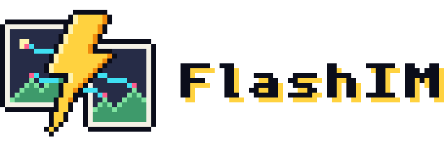

<p align="center">
  <picture>
    <source media="(prefers-color-scheme: dark)" srcset="https://raw.githubusercontent.com/lnexenl/FlashIM/main/assets/brand/lockup-dark@8x.png">
    
  </picture>
</p>

<p align="center">
  <b>Fast, quantized, multi-platform inference for image matching.</b><br>
  Dense and sparse matchers as native PyTorch ports, with FP8 / INT8 quantization and custom kernels.
</p>

<p align="center">
  <a href="#license">Code: Apache-2.0 with MIT and DINOv3 parts</a> ·
  <a href="https://github.com/lnexenl/FlashIM/blob/main/docs/licenses.md">Weights: per model, some non-commercial</a> ·
  <a href="https://github.com/lnexenl/FlashIM/blob/main/docs/models.md">Models</a> ·
  <a href="https://github.com/lnexenl/FlashIM/blob/main/docs/benchmarks.md">Inference benchmark</a> ·
  <a href="https://github.com/lnexenl/FlashIM/blob/main/docs/configuration.md">Configuration</a> ·
  <a href="https://github.com/lnexenl/FlashIM/blob/main/docs/platforms.md">Platforms</a> ·
  <a href="https://github.com/lnexenl/FlashIM/blob/main/docs/architecture.md">Architecture</a>
</p>

FlashIM runs image-matching models faster than their reference implementations, without giving up measured accuracy.
Every model is a native PyTorch port checked against the upstream code. The speedups come from quantization (MXFP8,
INT8), fused kernels (Triton, TileLang, CUDA C++) and `torch.compile`.

- **Custom kernels are first-class.** Every op has a torch reference (the correctness oracle and universal fallback) and
  optional optimized implementations that are picked by platform and shape.
- **Quantization with evidence.** FP8 / INT8 presets are accepted by task-level pose AUC (MegaDepth-1500, ScanNet-1500,
  HardMatch), not by tensor `allclose`.
- **Multi-platform by design.** Device detection separates vendor, dispatch key and ISA features. NVIDIA from Ampere to
  Blackwell today; ROCm, NPU and XPU are planned.
- **One interface.** Every model loads with `flashim.load(name, preset)`, where the preset is `fp32`, `bf16`, `int8` or
  `fp8`, and matches with `model.match(a, b)`, which returns the same `Matches` for dense, detector-free and sparse models.

## Install

On Linux x86-64 with Python 3.10 or newer, install the matching PyTorch 2.11 and torchvision 0.26 wheels first,
then install FlashIM from PyPI. The commands use CPU wheels by default. For an NVIDIA GPU, set `wheel` to the index
in the table that matches your hardware and driver. Blackwell GPUs need CUDA 12.8 or newer.

```bash
wheel=cpu
python -m pip install torch==2.11.0 torchvision==0.26.0 --index-url "https://download.pytorch.org/whl/$wheel"
python -m pip install flashim
```

| PyTorch build | Wheel index | Linux driver for the wheel's CUDA toolkit version |
|---|---|---|
| CPU only | `cpu` | None |
| CUDA 12.6 | `cu126` | 560.35.05+ |
| CUDA 12.8 | `cu128` | 570.124.06+ |
| CUDA 12.9 | `cu129` | 575.57.08+ |
| CUDA 13.0 | `cu130` | 580.95.05+ |

NVIDIA also supports minor-version compatibility from Linux driver 525.60.13 for CUDA 12.x and the R580 series for
CUDA 13.x. Applications that JIT-compile PTX can require a newer driver. See the [PyTorch wheel index](https://download.pytorch.org/whl/torch/),
[toolkit driver versions](https://docs.nvidia.com/cuda/archive/13.0.2/cuda-toolkit-release-notes/index.html#cuda-driver)
and [compatibility limits](https://docs.nvidia.com/deploy/cuda-compatibility/minor-version-compatibility.html).

FlashIM uses Triton 3.6 on Linux. Optional extras are `flashim[cv]` for OpenCV (SIFT, ORB and pose estimation),
`flashim[eval]` for accuracy benchmarks and `flashim[tilelang]` for the TileLang backend. For example, run
`python -m pip install 'flashim[cv]'`. On Jetson with JetPack 6, use NVIDIA's torch build and
[`requirements-jetson.txt`](https://github.com/lnexenl/FlashIM/blob/main/requirements-jetson.txt).

## Quick start

### Match two images on CPU

Run the example from the repository root to use the bundled Sacré-Cœur photos. If you installed from PyPI and have
no checkout, fetch the same two images into your current directory first.

```bash
mkdir -p assets
for photo in sacre_coeur1.jpg sacre_coeur2.jpg; do
  curl -fsSL "https://raw.githubusercontent.com/lnexenl/FlashIM/v0.1.1/assets/$photo" -o "assets/$photo"
done
```

XFeat runs in eager mode and downloads its 5.96 MiB checkpoint on first use. Each row of `keypoints_A` and
`keypoints_B` gives the pixel coordinates of one match in the original images. Use `device="cuda"` to run on a GPU.

```python
import flashim

model = flashim.load("xfeat", "fp32", device="cpu", engine="eager")
matches = model.match("assets/sacre_coeur1.jpg", "assets/sacre_coeur2.jpg", resize=640, max_matches=2048)
print(matches.keypoints_A.shape, matches.keypoints_B.shape, matches.confidence.shape)
```

### Dense matching on GPU

For repeated RoMaV2 FP8 inference on Blackwell, `compile-full` was the fastest FP8 engine in the
[GPU benchmark](https://github.com/lnexenl/FlashIM/blob/main/docs/benchmarks.md#dense-and-semi-dense-models).
The first match can take several minutes to compile. Reuse the model across pairs to benefit from the compiled kernels.

```python
import flashim

model = flashim.load(
    "romav2", "fp8", device="cuda", engine="compile-full", overrides={"arch.setting": "mega1500"}
)
matches = model.match("assets/sacre_coeur1.jpg", "assets/sacre_coeur2.jpg", max_matches=5000)
warp = matches.dense.warp_AB
```

`match(a, b, *, resize, max_matches, threshold)` is the same for every model: `resize` is the long side of the working
resolution, `max_matches` bounds the matches the model's own way (keypoints per image, the most confident matches, or
samples of a dense warp) and `threshold` is the model's match threshold. A model without the preset asked for builds the
nearest one it has (`fp8` -> `int8` -> `bf16` -> `fp32`), and a pipeline's preset applies to each of its components.
A usage example for every model is in [docs/models.md](https://github.com/lnexenl/FlashIM/blob/main/docs/models.md#usage-examples).
Image paths given to a model on CUDA are decoded on the GPU when they are JPEGs (nvJPEG);
`FLASHIM_IMAGE_DECODER=pil` decodes with PIL.

Weights download on first use into the torch hub checkpoint folder (`$TORCH_HOME/hub/checkpoints`) and are checked
against SHA-256 hashes pinned in `flashim/models/<model>/weights.py`; `checkpoint` or `FLASHIM_<MODEL>_CHECKPOINT` points to
a local file. See [docs/checkpoints.md](https://github.com/lnexenl/FlashIM/blob/main/docs/checkpoints.md).

```python
models = flashim.available_models()  # dict[str, str]: model name -> description
```
See [docs/models.md](https://github.com/lnexenl/FlashIM/blob/main/docs/models.md) for the full list, presets, and per-model usage examples.

## Models

[docs/models.md](https://github.com/lnexenl/FlashIM/blob/main/docs/models.md) lists every model with its presets and
default; the licenses are in [THIRD_PARTY_NOTICES.md](https://github.com/lnexenl/FlashIM/blob/main/THIRD_PARTY_NOTICES.md).

| category | models |
|---|---|
| Dense | `romav2`, `roma`, `roma-indoor`, `minima-roma`, `tiny-roma`, `ufm` |
| Dense 3D | `mast3r`, `dust3r` (FP16 compute under `bf16` / `int8` / `fp8`) |
| Detector-free | `loftr`, `minima-loftr`, `eloftr`, `xoftr` |
| Sparse extractors | `rdd`, `aliked`, `raco`, `raco-aliked`, `superpoint`, `disk`, `alike`, `xfeat`, `dedode`, `dedode-g`, `dad`, `ripe`, `ripepp`, `ripepp-aachen`, `ripepp-scared`, `sift`, `orb` |
| Sparse matchers and pipelines | `lightglue`, `<extractor>-lightglue`, `loma`, `superglue`, `superpoint-superglue`, `omniglue` |
| Sparse-to-dense | `flexglue` |

**Weight licenses.** The default SuperPoint and SuperGlue weights (Magic Leap), RIPE and RIPE++ weights
(Fraunhofer academic-use license v2.0), and MASt3R, DUSt3R and UFM weights (CC BY-NC-SA 4.0) are
**non-commercial**, including in pipelines that use them. RoMaV2 and FlexGlue include DINOv3 weights under the
DINOv3 License Agreement. Look up a model with `flashim.model_info(name)` or see the
[per-model license table](https://github.com/lnexenl/FlashIM/blob/main/docs/licenses.md).

## Configuring a run

The four presets are named partial configs; config files, dicts, dotted overrides and `load`'s keyword arguments
(`device`, `engine`, `strict`, `calibration`) layer on top.

```python
model = flashim.load("romav2", "fp8", overrides=["engine.kind=compile-full"])
model = flashim.load("raco-aliked-lightglue", "int8", config="run.toml")
flashim.resolve("rdd-lightglue", "fp8").to_dict()      # the config a build would use, without building
model.run_config.digest(), model.build_report          # what was asked for / what was actually applied
```

Unknown keys, passes and engines are errors; a pass the platform cannot run is skipped with a warning
(`optimize.strict=true` raises instead). See [docs/configuration.md](https://github.com/lnexenl/FlashIM/blob/main/docs/configuration.md).

## Platforms

`sm_120` (RTX 5070 Ti) is the primary target. `sm_90` (H20), `sm_89` (L20) and `sm_87` (Jetson AGX Orin) are tuned;
`sm_100` is compile-checked only; `sm_80` / `sm_86` are not tuned. A GPU without FP8 builds the nearest other preset
instead and says so in a warning and in `model.build_report.fallbacks`. Which model was tested on which GPU is in
[docs/platforms.md](https://github.com/lnexenl/FlashIM/blob/main/docs/platforms.md).

## Development

```bash
uv sync --extra eval                     # Python 3.12, torch 2.11 (cu130), triton 3.6
uv run pytest -m "not slow"              # unit / ops / quant
uv run pytest tests/parity               # bit-exactness vs the vendored upstream code (needs weights + GPU)
uv run python benchmarks/speed/forward.py --preset fp8 --engine compile
uv run python benchmarks/accuracy/run.py --dataset mega1500 --preset fp8 --seed 17
```

Agents and contributors: start with [AGENTS.md](https://github.com/lnexenl/FlashIM/blob/main/AGENTS.md) (layering rules,
how to add an op, backend, model or platform, and how changes are verified). The layout and op dispatch are described in
[docs/architecture.md](https://github.com/lnexenl/FlashIM/blob/main/docs/architecture.md).

## License

FlashIM is released under the Apache License 2.0 ([LICENSE](https://github.com/lnexenl/FlashIM/blob/main/LICENSE)), with two
exceptions inside the package: code ported from [RoMaV2](https://github.com/Parskatt/RoMaV2) (the RoMaV2 model and several
Triton kernels) is under RoMaV2's MIT license ([`licenses/RoMaV2-MIT.txt`](https://github.com/lnexenl/FlashIM/blob/main/licenses/RoMaV2-MIT.txt)),
and `flashim/models/romav2/dinov3.py` and `dpt.py` follow DINOv3 / DPT code by Meta under the DINOv3 License Agreement
([`licenses/DINOv3-License.md`](https://github.com/lnexenl/FlashIM/blob/main/licenses/DINOv3-License.md)). The package's
license expression is `Apache-2.0 AND MIT AND LicenseRef-DINOv3`. FlashIM downloads model weights from their
publishers under the terms in the [per-model license table](https://github.com/lnexenl/FlashIM/blob/main/docs/licenses.md).
For attribution and the licenses of vendored test code and assets, see
[THIRD_PARTY_NOTICES.md](https://github.com/lnexenl/FlashIM/blob/main/THIRD_PARTY_NOTICES.md).

<p align="center">
  &nbsp;&nbsp;
  &nbsp;&nbsp;
  
</p>
